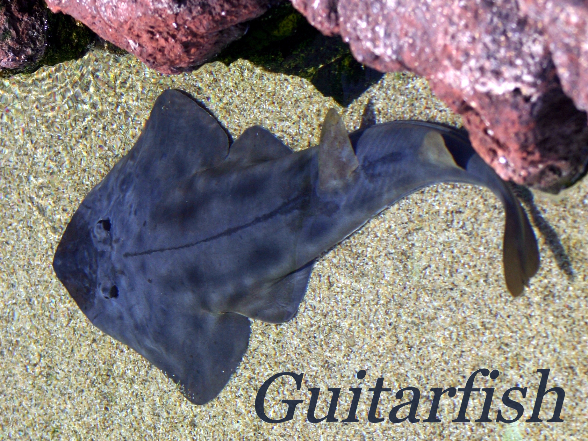

Guitarfish (6.4.54@6.5) is an open-source UCI-compliant chess engine written in Python, featuring a custom 64-bit bitboard move generator accelerated by Numba JIT and an evaluation function powered by a neural network (Custom NNUE).

---

## Play on Lichess

Guitarfish runs live as an official bot on Lichess: [@guitarfish-engine](https://lichess.org/@/guitarfish-engine).

- **Rapid Rating:** ~2200 ELO
- **Blitz Rating:** ~1980 ELO
- **Challenge Policy:** Currently configured to accept **Blitz** and **Rapid** challenges only.

> **Note:** The engine is self-hosted on a local machine. If the bot is offline or not responding, the server is likely turned off while the author is away at school =)))

---

## Features

- **Engine Core:** Custom 64-bit bitboard implementation compiled to native machine code using Numba JIT.
- **Evaluation:** King-bucketed NNUE with 7,105 input feature IDs, dual 1,024-value accumulators, product pooling, and a single centipawn output head.
- **Search Algorithm:** Negamax with Principal Variation Search (PVS) and Alpha-Beta pruning.
- **Draw Handling:** Search respects claimable threefold repetition and the 50-move rule while continuing to search for a win instead of treating an optional draw claim as mandatory.
- **Search Safety:** Null-move pruning is disabled in minor-piece-only endings and near the 50-move limit; quiescence detects stalemate at its depth cap and en-passant captures are classified only for actual pawn captures.
- **Pruning & Reductions:**
  - Singular Extensions (SE)
  - Null Move Pruning (NMP)
  - Reverse Futility Pruning (RFP)
  - Futility Pruning (FP)
  - Late Move Pruning (LMP)
  - Dynamic Late Move Reductions (LMR)
  - Delta pruning in Quiescence Search, guarded when a pawn can promote
  - Lazy Static Exchange Evaluation (SEE) pruning in Quiescence Search
  - Native noisy-move generation for captures and promotions in Quiescence Search
- **Move Ordering:**
  - Transposition Table (TT) move
  - Good captures sorted by MVV-LVA and SEE
  - Killer moves (2 slots per ply)
  - Countermove heuristic
  - History heuristic with aging
  - Losing captures demoted below quiet moves
- **Transposition Table:** 64-bit PolyGlot Zobrist hashing with mate-distance ply adjustments.
- **Opening Book:** Native PolyGlot (`.bin`) binary search support.
- **Model Packaging:** Single `.gm` archive containing model weights, and metadata loaded directly from memory.

---

## Architecture Overview

### 1. Neural Network Evaluation

| Component | Specification |
| :--- | :--- |
| **Raw Features** | 1,729 sparse features: 768 piece-square features plus 961 combat, king-safety, and pawn-structure features |
| **King Buckets** | 8 buckets (4 rank bands × 2 mirrored file groups); piece-square features expand to 6,144 bucketed IDs |
| **Embedding Input** | 7,105 active feature IDs (6,144 bucketed piece-square + 961 auxiliary); padding ID 7,105; at most 256 active IDs per side |
| **Feature Transformer** | Shared embedding weights and bias; separate side-to-move/opponent accumulators ($2 \times 1024$) |
| **Pooling** | Clamp accumulators to $[0,1]$, product-pool each 1,024-value accumulator into 512 values, then concatenate to 1,024 |
| **Hidden Layers** | $\text{Linear}(1024 \to 64) \to [c, c^2] \ (64 \to 128) \to \text{Linear}(128 \to 32)$ |
| **Activation** | **Dual activation** ($c \parallel c^2$) after FC1; **SCReLU** ($\text{clamp}(x,0,1)^2$) after FC2 |
| **Output** | Single head, $\text{Linear}(32 \to 1)$, scaled to centipawns by $410.0$ |
| **Training Loss** | Soft-target BCE (WDL), with target probability $\sigma(\text{CP} / 410)$ |

The 8-way king bucket is selected independently for each perspective from that side's king square. The training dataset can use the original 1,729-feature binary data and applies the bucket offset while loading samples.

### 2. Training Data and Configuration

The training pipeline downloads the first three Parquet shards from the [Lichess position-evaluations dataset](https://huggingface.co/datasets/Lichess/chess-position-evaluations). It keeps positions with a centipawn score, no mate score, search depth of at least 24, and an absolute score no greater than 1,200 cp. Duplicate FENs are removed, and scores are converted to the side-to-move perspective.

Features are extracted with the engine's bitboard module and stored as memory-mapped binary files. The first 50,000 positions are held out for validation; the rest are used for training. The configured run uses 16 epochs, a batch size of 8,192, AdamW, cosine learning-rate decay, automatic mixed precision on CUDA, and gradient clipping. Stochastic Weight Averaging starts at epoch 9.

In the supplied training run, filtering produced 21,205,317 positions. The best reported SWA checkpoint reached a validation loss of 0.67267 and a mean absolute error of 79.7 cp at epoch 11. These are training-run results, not a playing-strength guarantee.


### 3. Move Generation Benchmark

Perft test on the standard starting position:

| Library | Depth | Nodes | Time | Speed |
| :--- | :--- | :--- | :--- | :--- |
| `python-chess` (baseline) | 4 | 197,281 | 1.83 s | ~108,000 NPS |
| **`custom bitboard` (Numba JIT)** | 4 | 197,281 | 0.034 s | **~5,720,000 NPS** |

---

## Requirements

- Python 3.9 or higher
- NumPy
- Numba
- ONNX Runtime

Install dependencies via `pip`:

```bash
pip install -r requirements.txt
```

---

## Installation & Usage

Clone the repository:

```bash
git clone https://github.com/memeviber/guitarfish-chess-engine.git
cd guitarfish-chess-engine
```

### Running the UCI Engine

Launch the engine via command line:

```bash
python guitarfish.py
```

The default evaluation file is `guitarfish.gm`; the opening book is disabled by default. Optional positional arguments are the evaluation file, opening book, and transposition-table size in MiB:

```bash
python guitarfish.py guitarfish.gm book.bin 256
```

The TT size can also be changed at runtime with the UCI option `Hash` (1-1024 MiB). If the evaluation file is missing, startup reports an error.

To build a standalone Windows executable with the default model bundled (and no opening book), run:

```powershell
python -m PyInstaller --clean --noconfirm --onefile --name Guitarfish --add-data "guitarfish.gm:." guitarfish.py
```

The executable is created at `dist/Guitarfish.exe`. It uses the bundled model by default; passing an evaluation-file path as the first argument overrides it.

Standard UCI commands example:

```text
uci
isready
position startpos moves e2e4 e7e5
go depth 10
```

The engine outputs standard UCI search information (`depth`, `seldepth`, `score`, `nodes`, `nps`, `pv`) and terminates with `bestmove`.

Run the search regression suite with:

```bash
python -m unittest discover -s tests
```

---

## Lichess Bot Integration

Guitarfish is compatible with [`lichess-bot`](https://github.com/ShailChoksi/lichess-bot).

Example `config.yml` snippet:

```yaml
engine:
  dir: "./"
  name: "python"
  arguments:
    - "guitarfish.py"
    - "guitarfish.gm"
    - "book.bin"
  protocol: "uci"
  ponder: false
```

---

## About the Name

The engine is named after the **guitarfish** (*Rhinobatidae*), a real family of rays characterized by a flattened body and an elongated snout resembling an acoustic guitar.

---

## Acknowledgments

- **Image Credit:** Shovelnose guitarfish photo by [Jot Powers](https://commons.wikimedia.org/wiki/File:Shovelnose_guitarfish.JPG), color-adjusted by Togabi via Wikimedia Commons, licensed under [CC BY-SA 2.0](https://creativecommons.org/licenses/by-sa/2.0/), further edited by [memeviber](https://github.com/memeviber).
- **AI Assistance:** This engine was developed with the assistance of Gemini, accelerating algorithmic design, debugging, and overall development speed by an estimated 16x.

---

## License

This project is open-source and available under the [Apache License 2.0](LICENSE).